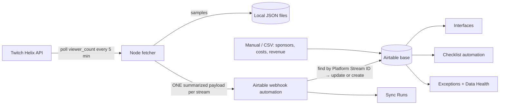

# StreamOps

**An Airtable-first livestream production command center, built to run on Airtable's Free plan.**

StreamOps plans livestreams, coordinates production, tracks sponsorships and costs, ingests performance data, and keeps that data honest when integrations fail. Airtable is the system: schema, logic, dashboards and workflows live in the base. Code exists only where Airtable can't reach (calling Twitch) or shouldn't hold data (high-volume viewer samples, credentials).

> **Status:** MVP built. The Airtable base, interface and checklist automation exist and are loaded with synthetic data. The Twitch fetcher is scaffolded and tested; the webhook ingest automation needs one sample payload to finish (see [runbooks](docs/runbooks.md#finish-the-webhook-ingest-automation)).

## What's in the base

| Layer | What exists |
|---|---|
| **Tables (10)** | Streams, Creators, Campaigns, Campaign Deliverables, Production Tasks, Performance, Expenses, Revenue, Sync Runs, Exceptions |
| **Stable IDs** | Every table has an immutable ID formula (`"STR-" & RECORD_ID()`, etc.); external IDs live in separate fields |
| **Logic** | Rollups for cost, actual/invoiced/estimated revenue, contracted sponsorship and viewers, all returning **blank, not 0** when unknown; contribution margin; required-field checks; status-aware staleness; a single `Data Completeness` status |
| **Interface** | *StreamOps Command Center*: Production Overview, Performance & Finance, Data Health, Exception Review Queue |
| **Automations** | Generate production checklist (draft, one run per stream); Ingest Twitch sync payload (draft, webhook upsert) |
| **Data** | 221 synthetic records with deliberate failures for every demo scenario |

**Web dashboard:** a dark control-room front end in [`web/`](web/README.md) reads the base and shows what's on air, the week's schedule, data health and finance. Run it with `cd web && npm install && npm run dev`; it works on a demo snapshot until you add a read-only Airtable token.

Full field-level documentation: [docs/schema.md](docs/schema.md). Every field also carries an Airtable field description, so the base documents itself.

## Architecture



**Source of truth:** Airtable owns production workflow records. Twitch owns its metrics. The fetcher owns raw samples and credentials. Nothing secret, and no per-poll event, is stored in Airtable.

## Why it's shaped this way (Free plan)

| Constraint (Free) | Design response |
|---|---|
| 1,000 records per base | Viewer samples stay in local files; Airtable gets one Performance row per stream. Synthetic set uses 221. |
| 100 automation runs / month | Formulas, rollups and filtered interface views do the monitoring (free). Automations fire on events only: ~1 run per stream. |
| No "Run a script" action | Upsert is built with no-code steps: webhook → Find records → conditional update/create. |
| Webhook trigger has no signature verification | URL kept only in `.env`; payload carries a shared token the automation checks. |
| Send email only to base collaborators | Alerts go to the base owner; Exceptions + Data Health are the primary signal. |

Decisions and trade-offs: [docs/architecture-decisions.md](docs/architecture-decisions.md).

## Demo scenarios (all present in the synthetic data)

| Scenario | Where to see it |
|---|---|
| Happy path | Completed streams with metrics, costs, revenue and a margin |
| Duplicate payload | Two *Co-op Chaos* rows share Platform Stream ID `4100000006` → Data Health › Duplicate platform IDs + an Exception |
| Expired credentials | *Retro Speedrun Night*: failed Sync Run (401), Critical Exception, `Never synced`, `Awaiting metrics` |
| Missing Stream ID | Ad payout referencing a non-existent stream: quarantined (`Unmatched - quarantined`), never auto-assigned. A merch payout with no reference shows `Unmatched - needs exception` |
| Delayed data | *Volt Energy 12-Hour Charity Stream*: last sync ran before the stream ended → `Stale`, `Stale metrics` |
| Unknown ≠ zero | *Fall Baking Special*: no costs yet → `Awaiting costs`, margin blank instead of fake profit |

## Repository layout

```text
streamops/
├── README.md
├── docs/
│   ├── schema.md                  # tables, fields, formulas, IDs
│   ├── architecture-decisions.md  # ADRs
│   ├── api-contracts.md           # webhook payload contract
│   └── runbooks.md                # setup, recovery, finishing steps
├── integrations/                  # Node 20 + TypeScript fetcher
│   ├── src/clients/               # Twitch (app token, 401 refresh), Airtable webhook, retrying fetch
│   ├── src/jobs/                  # live poller, sample store, schema-capture sender
│   ├── src/transforms/            # aggregation + payload validation (pure, tested)
│   ├── src/observability/         # JSON logs with secret redaction
│   └── tests/
├── scripts/send-sample.sh         # curl version of the schema-capture sample
└── examples/synthetic-data/       # CSVs matching what's loaded in the base
```

## Quick start

1. Open the **StreamOps** base → Interfaces → *StreamOps Command Center*.
2. Read [docs/runbooks.md](docs/runbooks.md) and turn on *Generate production checklist* (check your run budget first).
3. To connect Twitch: register an app, copy `integrations/.env.example` to `.env`, send the sample payload, finish the webhook automation, then `npm run poll`.

```bash
cd integrations
npm install
npm test          # 7 tests: aggregation, validation, secret redaction
npm run typecheck
```

## Security

- Credentials live only in `integrations/.env` (git-ignored). Logs redact token/secret/URL keys.
- The webhook URL is a capability; treat it like a password and rotate it if leaked (recreate the trigger).
- All data in this repo and the base is synthetic. Brands and creators are fictional.

## Roadmap

- Email alert automation for Critical/High exceptions (one run each)
- AI summaries per stream once AI credits allow; reviewed before they touch operational fields
- Move viewer samples to SQLite; add a scheduled host for the poller
- Upgrade path: on Team, replace the no-code upsert with a script action and add a Key Registry for duplicate prevention

## License

To be selected before public distribution.
