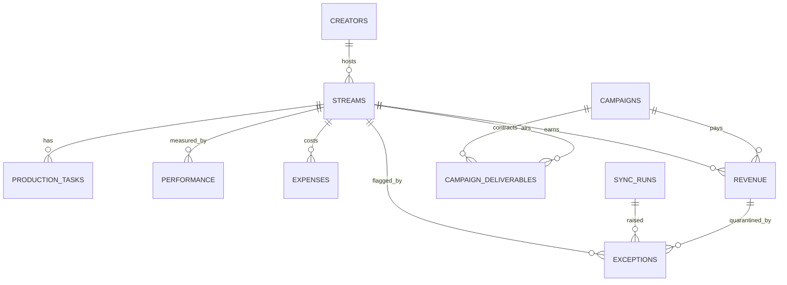

# StreamOps schema

Base: **StreamOps** (`appk1TDkLadEimZ98`). Times are stored in UTC and displayed in America/Los_Angeles. Currency is USD only in the MVP.

Conventions:

- **Primary field = human label** (Title, Task, Summary…). Never used as a key.
- **`<Table> ID` = stable internal key**: formula `"<PREFIX>-" & RECORD_ID()`. Airtable record IDs never change for the life of a record, so neither does this. It only changes if a record is deleted and re-created, which is treated as a new entity.
- **External IDs are separate fields** (`Platform Stream ID`, `Platform Channel ID`) and are what integrations match on.
- **Unknown is blank, never 0.** Rollups use `IF(COUNT(values) = 0, BLANK(), SUM(values))`.
- **Provenance** on synced records: `Source System`, `Source Updated At`, `Last Synced At`.

## Relationships

Campaign Deliverables is a **junction table**: a plain Campaign↔Stream link can't hold per-stream contract value, deliverable type or a "delivered" flag.

## Streams — canonical registry

| Field | Type | Notes |
|---|---|---|
| Title | text (primary) | Display only |
| Stream ID | formula | `"STR-" & RECORD_ID()` — shared business key |
| Status | single select | Draft, Scheduled, Live, Completed, Cancelled |
| Scheduled At / Started At / Ended At | dateTime | |
| Platform | single select | Twitch, YouTube, Kick (MVP integrates Twitch) |
| Platform Stream ID | text | Upsert match key |
| Source System / Source Updated At / Last Synced At | select / dateTime | Provenance |
| Creator | link → Creators | Exactly one expected |
| Creator Name | lookup | |
| Creator Count | count | Drives "Multiple creators" check |
| Stream Cost | rollup | Approved expenses only; blank if none |
| Actual / Invoiced / Estimated Revenue | rollups | Kept separate on purpose |
| Contracted Sponsorship | rollup | From Campaign Deliverables; contracted, not realized |
| Contribution Margin | formula | `ROUND(Actual Revenue − Stream Cost, 2)`; blank if either is unknown |
| Avg Viewers / Peak Viewers / Watch Hours (Est.) | rollups | From Performance |
| Open Tasks / Overdue Tasks / Open Exceptions | rollups | Sum of 0/1 helper fields |
| Missing Fields | formula | Status-aware required-field list. Empty = valid |
| Sync Freshness | formula | N/A (not started) · Not linked to platform · Never synced · Stale · Fresh. Live: stale after 60 min. Completed: stale if last sync was before the stream ended |
| Data Completeness | formula | Incomplete · Stale metrics · Awaiting metrics · Awaiting costs · Awaiting revenue · Complete |
| Display Label | formula | `date · Title (Creator)`. Suggested primary field (set in UI) |

## Creators

Display Name (primary), Creator ID, Channel Login, Platform Channel ID, Contact Email (business only), Status, Streams (link).

## Campaigns

Campaign Name (primary), Campaign ID, Brand, Contract Value (contracted), Contract Status, Start/End Date, Allocated to Streams (rollup), Received to Date (rollup of actual revenue), Deliverables Delivered (rollup text).

## Campaign Deliverables

Deliverable (primary), Deliverable ID, Deliverable Type, Allocated Value, Delivered (checkbox), Campaign (link), Stream (link), Stream Status (lookup).

## Production Tasks

| Field | Notes |
|---|---|
| Task (primary), Task ID, Status, Priority, Owner (collaborator), Owner Role | |
| Stream | link |
| Hours Before Stream | number, set by the checklist automation (negative = after) |
| Stream Start | rollup of the stream's Scheduled At |
| Due At | manual override |
| Effective Due | `Due At` if set, else `DATEADD(Stream Start, -Hours Before Stream, 'hours')`. Follows reschedules |
| Is Open / Is Overdue | 0/1 helpers. `NOW()` refreshes periodically, so overdue is approximate |

## Performance

One row per stream per source. Metric Label (primary), Performance ID, Source, Captured At, Avg Viewers, Peak Viewers, Watch Hours (Est.), Sample Count, Metric Basis (Measured/Estimated), Source Updated At, Last Synced At, Stream (link).

Twitch exposes only a live `viewer_count`; averages, peaks and watch hours are computed from polled samples outside Airtable. Watch hours are always an **estimate**.

## Expenses

Description (primary), Expense ID, Vendor, Category, Amount, Currency Code (USD), Approval Status, Incurred On, Stream (link), Approved Amount (formula: amount only if Approved).

## Revenue

Description (primary), Revenue ID, Category, Amount, Currency Code, Recognition Status (Estimated/Invoiced/Received), Recognized On, External Reference, Stream (link), Campaign (link), Exceptions (link), Actual/Invoiced/Estimated Amount (helper formulas), Match Status (Matched · Unmatched - quarantined · Unmatched - needs exception).

## Sync Runs

Run Label (primary), Sync Run ID, Integration, Started At, Ended At, Status (Running/Succeeded/Partial/Failed), Records Processed, Error Message (sanitized, never tokens), Retry Outcome, Duration (sec), Exceptions (link).

## Exceptions

Summary (primary), Exception ID, Type, Severity, Status (Open/Investigating/Resolved/Won't Fix), Owner, Detected At, Resolved At, Days Open, Resolution Notes, Stream / Sync Run / Revenue Record (links), Is Open.

## Record budget (Free: 1,000 per base)

| Table | Seed rows |
|---|---|
| Streams | 21 |
| Creators / Campaigns | 5 / 5 |
| Campaign Deliverables | 12 |
| Production Tasks | 90 |
| Performance | 11 |
| Expenses / Revenue | 37 / 27 |
| Sync Runs / Exceptions | 7 / 6 |
| **Total** | **221** |

Sync Runs is the table that grows; summarize or delete old successful runs monthly.
